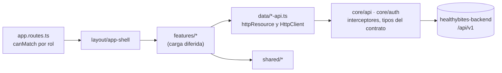

<div align="center">

<h1>Healthy Bites · Web app</h1>

<p><strong>Aplicación web de la plataforma de nutrición, hábitos y comunidad Healthy Bites.</strong></p>


[Funcionalidad](#funcionalidad) · [Arquitectura](#arquitectura) · [Ejecución local](#ejecución-local) ·
[Configuración](#configuración) · [Pruebas](#pruebas-y-calidad) · [Decisiones](#decisiones) · [Equipo](#equipo)

</div>

## Sobre el proyecto

**Healthy Bites** reúne en una sola plataforma planes alimenticios creados por nutricionistas, contenido educativo,
seguimiento de metas y hábitos, rachas con recompensas y una comunidad para compartir avances.

Este repositorio contiene la **aplicación web**: una SPA en Angular con un área para cada rol. Nació como proyecto
académico y se ha rehecho con las versiones y prácticas actuales: Angular sin zone.js, signals, Signal Forms,
PrimeNG con un tema propio y pruebas de accesibilidad automáticas. Forma parte de tres repositorios:

| Repositorio                                                                       | Descripción                                           |
| --------------------------------------------------------------------------------- | ----------------------------------------------------- |
| [healthybites-backend](https://github.com/vfernandezg-dev/healthybites-backend)   | API REST en Spring Boot + PostgreSQL                  |
| [healthybites-frontend](https://github.com/vfernandezg-dev/healthybites-frontend) | Aplicación web en Angular (este repo)                 |
| [healthybites-landing](https://github.com/vfernandezg-dev/healthybites-landing)   | Landing page en Astro (enlaza al registro y al login) |

## Funcionalidad

| Rol           | Rutas           | Qué puede hacer                                                                                                                                                                                                                                                 |
| ------------- | --------------- | --------------------------------------------------------------------------------------------------------------------------------------------------------------------------------------------------------------------------------------------------------------- |
| Cliente       | `/client`       | Ver su panel; marcarse una meta de peso con sus pesajes, un gráfico y una recomendación saludable; registrar hábitos a diario; completar rachas y ganar premios; seguir planes alimenticios; leer contenido; suscribirse con PayPal; participar en la comunidad |
| Nutricionista | `/nutritionist` | Ver su panel; crear planes con sus comidas y publicarlos; publicar artículos, vídeos y guías con portada y fichero; crear recompensas; ver a sus clientes; participar en la comunidad                                                                           |
| ADMIN         | `/admin`        | Ver el resumen de la plataforma; activar y desactivar cuentas; invitar nutricionistas; moderar las denuncias; consultar suscripciones, pagos e ingresos                                                                                                         |

El acceso es por invitación para los nutricionistas: el registro público (`/auth/register`) solo crea clientes. Las
rutas `/auth/login` y `/auth/register` son las que enlaza la landing.

## Arquitectura

```text
src/app/
├── core/       Servicios únicos de la app: sesión (auth), cliente de la API y sus tipos, interceptores,
│               avisos y confirmaciones, título de la pestaña, navegación y salidas externas, tema de PrimeNG.
├── layout/     Marco: layout de autenticación, shell con menú lateral (cajón en móvil) y página 404.
├── shared/     Piezas reutilizables sin estado de negocio: listados paginados (pagedQuery, PagedGrid), formularios
│               (formSubmitter, FormDialog), escrituras (mutation), tarjetas y celdas, pipes, gráfico de peso.
└── features/   Una carpeta por funcionalidad: data/ (su API, stores de página, funciones puras), ui/
                (presentacionales) y sus páginas y diálogos.
                auth · dashboard · profile · progress · habits · rewards · meal-plans · content ·
                community · subscription · nutritionist-clients · admin
```

Las capas se importan con alias (`@core`, `@shared`, `@layout`, `@features`) y ESLint comprueba sus fronteras: de
otra funcionalidad solo se usa su `data/`. Cómo se escribe cada cosa (estado, formularios, diálogos, listados) está en
la [guía del frontend](docs/frontend-guidelines.md).



- **Angular 22 sin zone.js.** Detección de cambios `OnPush` (la de serie) y estado con signals: `input()`,
  `computed`, `linkedSignal`, `resource`. Las lecturas son `httpResource`; las escrituras, `HttpClient` convertido en
  promesas.
- **Formularios con Signal Forms** (`@angular/forms/signals`), con los mismos límites que la validación de la API y
  sus errores de campo (422) puestos en cada campo.
- **Carga diferida por rol.** Cada área (`/client`, `/nutritionist`, `/admin`) se protege con `canMatch`: el código
  de las áreas de otros roles ni se descarga. Cada funcionalidad carga sus rutas aparte, y lo pesado (Apache
  ECharts) espera a `@defer`.
- **Tipos generados del contrato.** `src/app/core/api/schema.d.ts` sale de `openapi.yaml` de la API
  ([ADR 0004](docs/adr/0004-tipos-desde-openapi.md)).
- **Errores RFC 9457.** El interceptor convierte cada `ProblemDetail` en un aviso (solo en las escrituras); los
  formularios muestran el mensaje de la API en su sitio.
- **Diálogos declarativos.** Se crean al abrirlos dentro de un `@defer`, cada uno en su chunk, y piden sus datos solo
  entonces ([ADR 0008](docs/adr/0008-dialogos-declarativos-y-stores-de-pagina.md)).
- **CSP y cabeceras de seguridad** en `vercel.json`, aplicadas también en las pruebas E2E, que fallan ante cualquier
  violación ([ADR 0009](docs/adr/0009-csp-y-cabeceras-de-seguridad.md)).

## Stack

| Área            | Tecnología                                                                                             |
| --------------- | ------------------------------------------------------------------------------------------------------ |
| Framework       | Angular 22 (zoneless, standalone, signals, Signal Forms), TypeScript 6                                 |
| Interfaz        | PrimeNG 22 (modo styled, preset propio sobre Aura), Tailwind CSS 4 con tokens propios                  |
| Iconos y fuente | Lucide (`@lucide/angular`), Plus Jakarta Sans (la misma tipografía que la landing)                     |
| Gráficos        | Apache ECharts 6 con ngx-echarts (solo los módulos usados, con SVG)                                    |
| Configuración   | Variables `NG_APP_*` con `@ngx-env/builder`                                                            |
| Pruebas         | Vitest (unitarias), Playwright + `@axe-core/playwright` (E2E y accesibilidad)                          |
| Calidad         | TypeScript estricto, ESLint con tipos (angular-eslint, accesibilidad, fronteras entre capas), Prettier |
| Herramientas    | Node 26, pnpm 12 (con `minimumReleaseAge`), GitHub Actions, Dependabot, gitleaks                       |

## Ejecución local

### Requisitos

- **Node 26** (LTS). La versión exacta está en [`.nvmrc`](.nvmrc); con [fnm](https://github.com/Schniz/fnm) basta
  con `fnm use`.
- **pnpm 12**. La versión se fija en `packageManager` (`package.json`). El proyecto no se instala con npm ni con
  yarn: `preinstall` lo impide.
- La API en `http://127.0.0.1:8090` (ver el README de
  [healthybites-backend](https://github.com/vfernandezg-dev/healthybites-backend)).

### Pasos

```bash
pnpm install
cp .env.example .env   # opcional: los valores por defecto sirven para desarrollo
pnpm start             # http://localhost:4210
```

`pnpm start` redirige `/api` a la API ([`proxy.conf.json`](proxy.conf.json)): app y API comparten origen, así que la
cookie de sesión funciona sin CORS. Con el perfil de desarrollo de la API hay cuentas de prueba para cada rol.

## Configuración

Las variables se leen al compilar, desde `.env` o desde el entorno del build. Solo las que empiezan por `NG_APP_`
llegan al código, y acaban dentro del bundle: **aquí nunca va un secreto**.

| Variable                     | Por defecto                            | Uso                                                                |
| ---------------------------- | -------------------------------------- | ------------------------------------------------------------------ |
| `NG_APP_API_URL`             | `/api/v1`                              | URL base de la API. Completa si en producción vive en otro origen  |
| `NG_APP_LANDING_URL`         | `https://healthybites.vfernandezg.dev` | Enlace «Volver a la web» de las páginas de acceso                  |
| `NG_APP_PRIMENG_LICENSE_KEY` | (vacía)                                | Licencia Community de PrimeNG. Sin ella se ve un aviso de licencia |

La clave de PrimeNG es gratuita ([primeui.dev](https://primeui.dev)) y **caduca cada 12 meses**. `pnpm build:release`
falla si no está; en CI va en el secreto `PRIMENG_LICENSE_KEY`.

## Sesión y seguridad

- El **access token** (JWT de 15 minutos) vive **solo en memoria**, nunca en `localStorage`. El **refresh token**
  está en una cookie `HttpOnly` que JavaScript no puede leer; al recargar, la sesión se recupera con ella antes de
  la primera navegación ([ADR 0003](docs/adr/0003-sesion-en-memoria.md)).
- Ante un 401 por caducidad, la sesión se renueva una vez y la petición se reintenta. Hay un único refresh a la vez,
  también entre pestañas (Web Locks). Cerrar sesión la cierra en todas (BroadcastChannel).
- Los enlaces de los correos (restablecer la contraseña, aceptar una invitación) llevan el token en el fragmento
  (`#token=…`), que no viaja al servidor ni aparece en el `Referer`.
- Antes de ir a PayPal se comprueba que la URL de aprobación es de `paypal.com`. Las URLs de vuelta las construye
  la API.

## Diseño y accesibilidad

- Identidad «Despensa» ([ADR 0010](docs/adr/0010-identidad-despensa.md)):
  - el verde de la marca como estructura (menú y acceso en verde pino) sobre papel cálido;
  - tarjetas blancas con filete y un caqui para lo que pide atención.
- `src/styles/tokens.css` es la única fuente de colores, radios y sombras. El preset de PrimeNG (`core/theme`) lee
  esas variables y solo incluye los tokens de los componentes que se usan.
- `pnpm theme:check` comprueba, antes de los e2e:
  - el contraste AA de cada par de colores;
  - que ninguna plantilla use colores fuera de los tokens.
- Animaciones discretas de entrada (`src/styles/motion.css`), desactivadas con `prefers-reduced-motion`.
- Formularios con etiqueta visible, errores enlazados con `aria-describedby` y foco en el primer campo con error.
- Enlace para saltar al contenido, foco al contenido nuevo al navegar, título de pestaña por página, `lang="es"` y
  respeto a `prefers-reduced-motion`.
- Las tablas pasan a fichas en móvil sin perder la semántica de tabla.

## Pruebas y calidad

| Script                    | Qué hace                                                                        |
| ------------------------- | ------------------------------------------------------------------------------- |
| `pnpm start`              | Servidor de desarrollo en el puerto 4210, con proxy a la API                    |
| `pnpm build`              | Build de producción en `dist/`                                                  |
| `pnpm build:release`      | Build de producción que exige la clave de PrimeNG                               |
| `pnpm lint`               | ESLint con tipos (plantillas, accesibilidad, fronteras entre capas)             |
| `pnpm typecheck:e2e`      | Comprueba los tipos de las pruebas E2E (Playwright no lo hace)                  |
| `pnpm format`             | Prettier (y `format:check` para comprobarlo)                                    |
| `pnpm test`               | Tests unitarios (Vitest)                                                        |
| `pnpm test:e2e`           | E2E con Playwright y axe sobre el build, con la CSP de producción               |
| `pnpm test:e2e:fullstack` | Recorridos contra la API real, antes de cada release (`e2e-fullstack/`)         |
| `pnpm api:sync`           | Copia `docs/openapi.yaml` de la API hermana y regenera los tipos                |
| `pnpm api:check`          | Falla si los tipos generados no coinciden con el contrato commiteado            |
| `pnpm theme:check`        | Falla si el preset no trae los tokens de algún componente de PrimeNG que se usa |
| `pnpm verify`             | Lint, tipos E2E, formato, contrato, tema, tests y build (CI antes de los E2E)   |

- **E2E con la API simulada** (`page.route`): cada funcionalidad tiene su recorrido por rol, y
  [`e2e/routes.spec.ts`](e2e/routes.spec.ts) visita todas las rutas comprobando el título, el `h1`, que no queden
  peticiones sin simular ni errores y que axe no encuentre fallos WCAG 2.2 AA
  ([ADR 0005](docs/adr/0005-pruebas-e2e-con-api-simulada.md)).
- **Contra la API real** ([`e2e-fullstack/`](e2e-fullstack/README.md)): antes de cada release, los recorridos de
  cliente, nutricionista y ADMIN se ejecutan contra la API con sus datos de demostración, incluidos el correo de
  invitación (Mailpit) y el contrato de contacto con la landing.
- **Presupuestos:** el bundle inicial ronda los 556 kB (150 kB comprimido); el build avisa a partir de 600 kB y
  falla a partir de 700 kB.
- **CI** ([`.github/workflows/ci.yml`](.github/workflows/ci.yml)): instalación con lockfile, lint, formato,
  contrato, tema, tests, build y E2E en cada pull request, más gitleaks. Dependabot actualiza npm y Actions.

## Decisiones

Las decisiones de arquitectura están en [`docs/adr`](docs/adr/README.md): Angular sin zone.js, PrimeNG con Tailwind y
tema propio, la sesión en memoria, los tipos generados del contrato, las pruebas con la API simulada, los gráficos
con ECharts, las capas con sus fronteras, los diálogos declarativos con los stores de página, la CSP y la identidad
visual. La
[guía del frontend](docs/frontend-guidelines.md) es su versión práctica.

## Equipo

Healthy Bites es un proyecto académico. **Valentin Fernandez** lideró el proyecto y desarrolló y configuró la
plataforma completa: la API REST, esta aplicación web, la landing (Astro), el despliegue y la integración continua.

| Integrante         | Rol                        | Perfil                                                                    |
| ------------------ | -------------------------- | ------------------------------------------------------------------------- |
| Valentin Fernandez | Líder técnico · Full Stack | [LinkedIn](https://www.linkedin.com/in/vfernandezg-dev/)                  |
| Camila Moreno      | Diseño UI/UX               | [LinkedIn](https://www.linkedin.com/in/camila-moreno-quevedo-01871a324/)  |
| Alessia Aguilar    | Base de datos              | [LinkedIn](https://www.linkedin.com/in/alessia-aguilar-857670286/)        |
| Jhonnatan Chavez   | Arquitectura de software   | [LinkedIn](https://www.linkedin.com/in/jhonnatan-del-castillo-a73a24316/) |
| Renzo Lavado       | Comercial                  | [LinkedIn](https://www.linkedin.com/in/renzo-lavado-41aba2296/)           |
